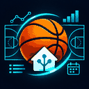
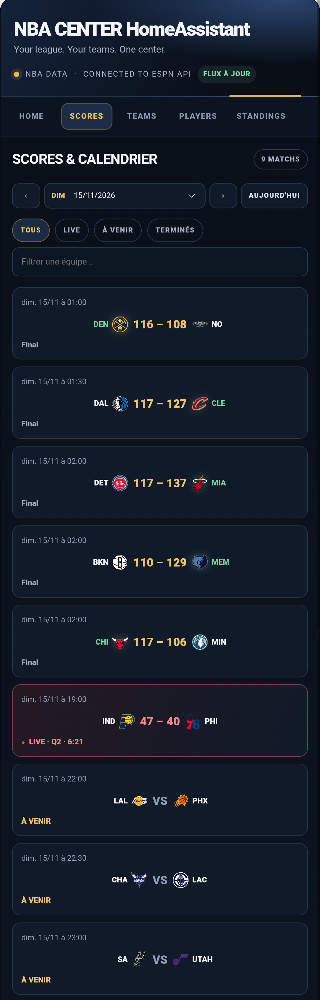
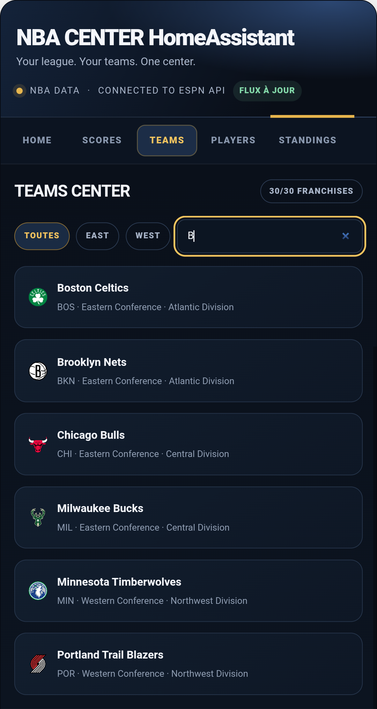
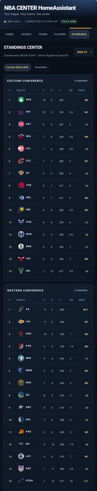

# 🏀 NBA Center HomeAssistant

<p align="center">
  <strong>Le basket NBA au cœur de votre Home Assistant.</strong><br>
  Suivez les matchs, explorez les équipes et les joueurs, et retrouvez les statistiques dans une interface Lovelace immersive au thème NBA Dark.
</p>

<p align="center">
  <a href="https://github.com/cy-bertrand/nba-center-ha/actions/workflows/validate-hacs.yml">
    
  </a>
  <a href="https://github.com/cy-bertrand/nba-center-ha/actions/workflows/build-frontend.yml">
    
  </a>
  <a href="https://github.com/cy-bertrand/nba-center-ha/blob/main/LICENSE">
    
  </a>
  <a href="https://www.buymeacoffee.com/cybertrand">
    
  </a>
</p>

<p align="center">
  
</p>

## 🏀 Toute la NBA dans votre tableau de bord

NBA Center HomeAssistant transforme votre Home Assistant en véritable centre de suivi NBA. Plus besoin de multiplier les sites et les applications : retrouvez l'essentiel de la saison dans une seule interface, directement depuis Lovelace.

Que vous souhaitiez suivre une rencontre en direct, consulter le calendrier, comparer les équipes ou découvrir les performances d'un joueur, NBA Center rassemble les informations dans une expérience visuelle sombre, moderne et pensée pour les fans de basket.

### Ce que vous pouvez faire

- **Suivre les matchs** — retrouvez les rencontres du jour, les matchs à venir et les résultats, avec les scores et les informations de match disponibles.
- **Explorer les équipes** — consultez les équipes NBA, leurs informations et leurs performances.
- **Découvrir les joueurs** — accédez aux fiches joueurs, à leurs statistiques et aux saisons disponibles.
- **Analyser les rencontres** — consultez les détails et les statistiques de match, dont les boxscores lorsqu'ils sont fournis par la source.
- **Profiter d'une interface dédiée** — navigation Lovelace, thème NBA Dark et affichage adapté à Home Assistant.
- **Recevoir des notifications de match** — un blueprint inclus avec l'intégration permet d'être averti au début et/ou à la fin des rencontres de vos équipes favorites.
- **Garder le contrôle dans Home Assistant** — l'intégration fournit également des entités, services et événements utilisables dans vos tableaux de bord et automatisations.

Les données sportives sont récupérées automatiquement depuis ESPN, sans clé API à configurer.

## 📸 Aperçu de l'interface

NBA Center propose plusieurs espaces pour suivre toute la saison NBA depuis Home Assistant.

### Accueil et suivi des rencontres

<p align="center">
  
  
</p>

### Le détail des matchs

<p align="center">
  
  
</p>

### Équipes et joueurs

<p align="center">
  
  
</p>

### Statistiques et classements

<p align="center">
  
  
</p>

## 🚀 Installation avec HACS

NBA Center HomeAssistant est conçu pour être installé via HACS.

1. Ouvrez **HACS → Intégrations**.
2. Ouvrez le menu **⋮ → Dépôts personnalisés**.
3. Ajoutez le dépôt suivant avec le type **Integration** :

   `https://github.com/cy-bertrand/nba-center-ha`

4. Recherchez **NBA Center HomeAssistant** et installez-le.
5. Redémarrez Home Assistant.
6. Allez dans **Paramètres → Appareils et services → Ajouter une intégration** et recherchez **NBA Center HomeAssistant**.

La carte Lovelace est enregistrée automatiquement lorsque Home Assistant utilise le mode Storage. Vous pouvez ensuite ajouter la carte à votre tableau de bord avec le type :

```yaml
type: custom:nba-center-ha-card
```

Pour les installations Lovelace en mode YAML ou pour les options avancées, consultez [le guide d'installation frontend](docs/FRONTEND-INSTALLATION.md) et les exemples dans [lovelace/](lovelace/).


### 🔔 Notifications automatiques des matchs

NBA Center fournit également un **blueprint Home Assistant** pour recevoir des notifications lors des matchs de vos équipes favorites.

Le blueprint permet de choisir :

- les téléphones ou appareils à notifier ;
- si vous souhaitez être averti au **début du match**, à sa **fin**, ou aux deux moments ;
- toutes vos équipes favorites ou une franchise NBA précise.

La notification de début annonce les équipes et l'heure locale. À la fin du match, elle indique le score final et, lorsque le score le permet, l'équipe gagnante.

**Aucune installation manuelle n'est nécessaire :** le blueprint est fourni avec l'intégration NBA Center. Après l'installation de l'intégration et le redémarrage de Home Assistant, il est disponible dans **Paramètres → Automatisations et scènes → Blueprints**. Il suffit de créer une automatisation à partir de **NBA Center – Notification de match**, puis de choisir les appareils et les équipes à suivre.

Le blueprint s'appuie sur les événements `nba_center_game_start` et `nba_center_game_end` émis par l'intégration.

## ☕ Soutenir le projet

NBA Center HomeAssistant est développé et maintenu avec passion. Si le projet vous plaît et que vous souhaitez encourager son développement, vous pouvez offrir un café :

<p align="center">
  <a href="https://www.buymeacoffee.com/cybertrand">
    
  </a>
</p>

Merci pour votre soutien ! ⭐

## 🔧 Pour les utilisateurs avancés

### Architecture

- Intégration Home Assistant autonome avec backend Python.
- Carte Lovelace développée en JavaScript avec Lit et Web Components.
- Les appels ESPN sont centralisés dans le backend : le frontend ne contacte pas directement ESPN.
- Cache des données, gestion des erreurs et respect du fuseau horaire Home Assistant.
- Bundle frontend précompilé et fourni dans le dépôt : aucune installation de Node.js n'est nécessaire sur Home Assistant.

### Développement frontend

Le code source Lit se trouve dans `frontend/src/nba-center-card.js`. Le bundle distribué à Home Assistant est généré dans `custom_components/nba_center/www/nba-center-card.js`.

```bash
npm ci
npm run build
npm test
```

### Contrôles automatisés

Les badges en haut de cette page reflètent directement les workflows GitHub :

- **HACS + Hassfest** : contrôles de validation du dépôt et de l'intégration Home Assistant.
- **Frontend build et tests** : compilation et tests du frontend.

Les résultats détaillés sont disponibles dans l'onglet [Actions](https://github.com/cy-bertrand/nba-center-ha/actions).

## 📄 Licence et droits tiers

Le code original de NBA Center HomeAssistant est distribué sous **licence MIT**. Vous pouvez l'utiliser, le copier, le modifier, le distribuer et l'utiliser commercialement, à condition de conserver l'avis de droit d'auteur et le texte de licence dans les copies ou portions substantielles du logiciel.

Consultez le fichier [LICENSE](LICENSE) pour le texte complet.

**Important :** NBA Center HomeAssistant est un projet indépendant, non affilié, approuvé ou sponsorisé par la NBA, ESPN ou Home Assistant. La licence MIT couvre uniquement le code sur lequel le projet détient les droits ; elle ne confère aucun droit sur les marques, logos, images, données ou services de tiers. Consultez [THIRD_PARTY_NOTICES.md](THIRD_PARTY_NOTICES.md) pour plus de précisions.
