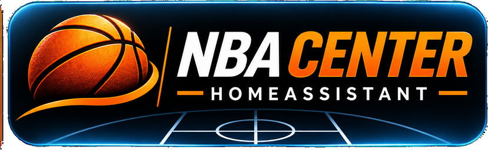
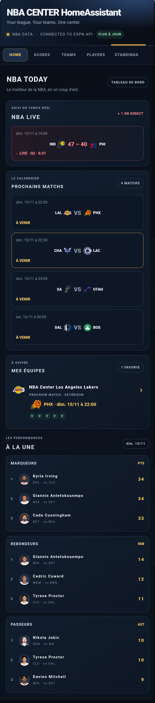
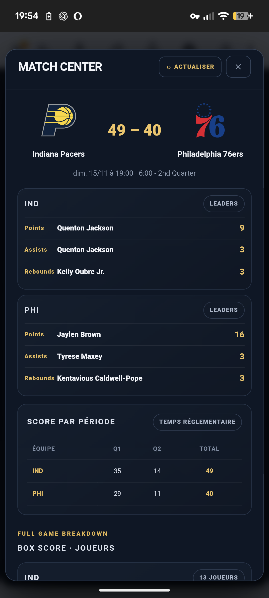
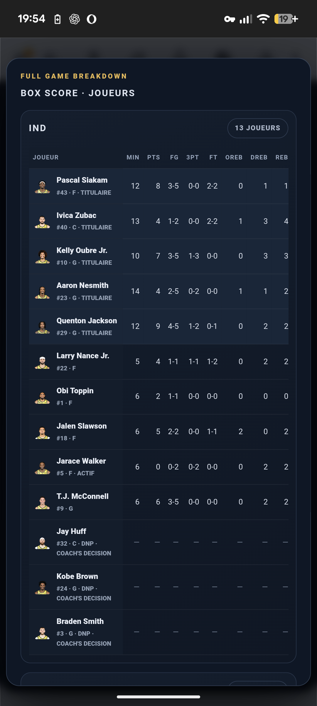
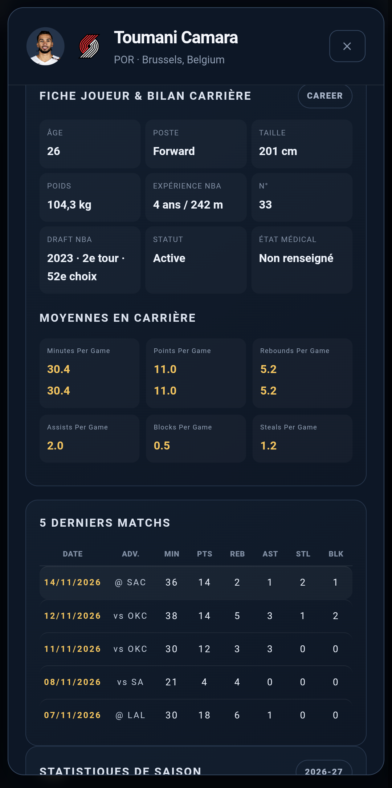
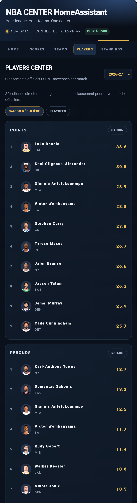

# 🏀 NBA Center HomeAssistant

<p align="center">
<strong>Le basket NBA au cœur de votre Home Assistant.</strong><br>
<strong>Bring the NBA experience into your Home Assistant.</strong><br>
Suivez les matchs, explorez les équipes et les joueurs dans une interface Lovelace immersive NBA Dark.<br>
Follow games, explore teams and players in an immersive NBA Dark Lovelace interface.
</p>

<p align="center"><a href="#français">🇫🇷 / 🇧🇪 Français</a> · <a href="#english">🇬🇧 English</a></p>

<p align="center">
<a href="https://github.com/cy-bertrand/nba-center-ha/actions/workflows/validate-hacs.yml"></a>
<a href="https://github.com/cy-bertrand/nba-center-ha/actions/workflows/build-frontend.yml"></a>
<a href="https://github.com/cy-bertrand/nba-center-ha/blob/main/LICENSE"></a>
<a href="https://www.buymeacoffee.com/cybertrand"></a>
</p>

<p align="center"></p>

---

<a id="français"></a>
# Fr

## Toute la NBA dans votre tableau de bord

NBA Center HomeAssistant transforme votre Home Assistant en véritable centre de suivi NBA. Retrouvez l'essentiel de la saison dans une seule interface, directement depuis Lovelace.

### Fonctionnalités

- **Matchs et scores** — rencontres du jour, matchs à venir, résultats et informations de match.
- **Match Center** — détails des rencontres, boxscores et Play-by-Play lorsque les données sont disponibles.
- **Teams Center** — exploration des franchises, informations et performances des équipes.
- **Players Center** — fiches joueurs, statistiques et saisons disponibles.
- **Classements et playoffs** — conférences, classements, playoffs et play-in.
- **Notifications** — blueprint Home Assistant pour être averti au début et/ou à la fin des matchs de vos équipes favorites.
- **Automatisations** — entités, services et événements utilisables dans Home Assistant.

Les données sportives sont récupérées automatiquement depuis ESPN, sans clé API à configurer.

### Langues et traductions

L'interface de configuration Home Assistant et les principaux écrans de la carte Lovelace prennent en charge le français et l'anglais. La langue de la carte suit la langue de l'interface Home Assistant, avec le français comme langue de repli. Pour ajouter une langue ou traduire de nouveaux libellés, consultez le [guide des traductions](docs/TRANSLATIONS.md).

### Entités, capteurs et service Home Assistant

Après la configuration, l'intégration crée l'appareil **NBA Center** et ses capteurs. Les capteurs principaux sont :

- `sensor.nba_center_matchs_du_jour` — nombre de matchs du jour, avec les rencontres et les équipes favorites dans ses attributs.
- `sensor.nba_center_catalogue_des_equipes` — catalogue des 30 franchises NBA.
- `sensor.nba_center_etat_du_flux_principal` — état des données ESPN, erreurs éventuelles et date de dernière vérification.
- `sensor.nba_center_classement_est` et `sensor.nba_center_classement_ouest` — classements des deux conférences.
- `sensor.nba_center_meilleurs_marqueurs`, `sensor.nba_center_meilleurs_rebondeurs`, `sensor.nba_center_meilleurs_passeurs`, `sensor.nba_center_meilleurs_intercepteurs` et `sensor.nba_center_meilleurs_contreurs` — leaders de la saison régulière.
- Les cinq capteurs correspondants suffixés `_playoffs` — leaders des playoffs.

Pour chaque équipe favorite sélectionnée dans la configuration, quatre capteurs supplémentaires sont créés : **Dernier match**, **Prochain match**, **Match en cours** et **Derniers matchs**. Leurs identifiants incluent le nom de la franchise.

L'intégration expose également le service **`nba_center.get_game_details`**. Il accepte le champ `game_id` et renvoie les détails disponibles d'une rencontre. Les événements **`nba_center_game_start`** et **`nba_center_game_end`** sont émis au début et à la fin des matchs et peuvent déclencher vos propres automatisations.

## 📸 Aperçu de l'interface

<p align="center"> </p>
<p align="center"> </p>
<p align="center"> </p>
<p align="center"> </p>

## 🚀 Installation

### Home Assistant 2026.11 et versions ultérieures — Marketplace

1. Ouvrez **Paramètres → Marketplace**.
2. Si NBA Center n'apparaît pas encore dans le catalogue, ouvrez **⋮ → Ajouter depuis un lien** (*Add from link*).
3. Saisissez `https://github.com/cy-bertrand/nba-center-ha`, puis validez.
4. Ouvrez **NBA Center HomeAssistant** et sélectionnez **Installer**.
5. Redémarrez Home Assistant si cela vous est demandé.
6. Dans **Paramètres → Appareils et services**, ajoutez **NBA Center HomeAssistant**.

Une fois le dépôt publié dans le catalogue officiel, vous pourrez simplement rechercher **NBA Center HomeAssistant** dans le Marketplace.

### Versions antérieures à 2026.11 — HACS

1. Ouvrez **HACS → Intégrations**.
2. Ouvrez **⋮ → Dépôts personnalisés**.
3. Ajoutez `https://github.com/cy-bertrand/nba-center-ha` avec le type **Integration**.
4. Recherchez **NBA Center HomeAssistant** et installez-le.
5. Redémarrez Home Assistant.
6. Dans **Paramètres → Appareils et services**, ajoutez **NBA Center HomeAssistant**.

En mode Lovelace **Storage**, la ressource de la carte est enregistrée automatiquement. Ajoutez ensuite une carte manuelle :

```yaml
type: custom:nba-center-ha-card
```

Pour le mode YAML et les options, consultez le [guide d'installation frontend](docs/FRONTEND-INSTALLATION.md).

## 🔔 Notifications de matchs

Le blueprint **NBA Center – Notification de match** est fourni avec l'intégration. Après installation et redémarrage, il est disponible dans **Paramètres → Automatisations et scènes → Blueprints**.

Créez une automatisation à partir de ce blueprint pour choisir les appareils à notifier, le début et/ou la fin des matchs, ainsi que toutes les équipes ou une franchise précise. Les événements `nba_center_game_start` et `nba_center_game_end` sont également disponibles pour vos automatisations personnalisées.

## 🔧 Architecture et développement

- Backend Python autonome pour les appels ESPN, le cache et les entités Home Assistant.
- Frontend JavaScript avec Lit et Web Components.
- Le frontend ne contacte jamais directement ESPN.
- Bundle précompilé fourni : Node.js n'est pas nécessaire sur Home Assistant.

Pour contribuer au frontend :

```bash
npm ci
npm run build
npm test
```

Le code source se trouve dans `frontend/src/nba-center-card.js` et le bundle distribué dans `custom_components/nba_center/www/`.

Guide de publication et de versionnement : [RELEASING.md](docs/RELEASING.md).

Documentation : [Architecture](docs/ARCHITECTURE.md) · [Installation de la carte](docs/FRONTEND-INSTALLATION.md) · [Plan de tests](docs/TEST-PLAN.md) · [Exemples Lovelace](lovelace/).

## ☕ Soutenir le projet

Vous pouvez [offrir un café](https://www.buymeacoffee.com/cybertrand) pour soutenir son développement.

## 📄 Licence et droits tiers

Le code original est distribué sous licence **MIT**. Consultez [LICENSE](LICENSE) et [THIRD_PARTY_NOTICES.md](THIRD_PARTY_NOTICES.md).

NBA Center HomeAssistant est un projet indépendant, non affilié, approuvé ou sponsorisé par la NBA, ESPN ou Home Assistant. La licence MIT ne confère aucun droit sur les marques, logos, images, données ou services de tiers.

---

<a id="english"></a>
# En

## 🏀 The NBA in your Home Assistant dashboard

NBA Center HomeAssistant turns your Home Assistant instance into an NBA hub. Follow the season from a single interface, directly in Lovelace.

### Features

- **Games and scores** — today's games, upcoming matchups, results and available game information.
- **Match Center** — game details, box scores and Play-by-Play when provided by the data source.
- **Teams Center** — explore NBA franchises, team information and performance.
- **Players Center** — player profiles, statistics and available seasons.
- **Standings and playoffs** — conference standings, playoffs and play-in coverage.
- **Notifications** — a Home Assistant blueprint to notify you when games start and/or finish for your favorite teams.
- **Automations** — entities, services and events available to your Home Assistant dashboards and automations.

Basketball data is retrieved automatically from ESPN. No API key is required.

### Home Assistant entities, sensors and service

After setup, the integration creates the **NBA Center** device and its sensors. The main sensors are:

- `sensor.nba_center_matchs_du_jour` — number of games today, with game and favorite-team data in its attributes.
- `sensor.nba_center_catalogue_des_equipes` — catalog of all 30 NBA franchises.
- `sensor.nba_center_etat_du_flux_principal` — ESPN data status, any errors and last check time.
- `sensor.nba_center_classement_est` and `sensor.nba_center_classement_ouest` — Eastern and Western Conference standings.
- `sensor.nba_center_meilleurs_marqueurs`, `sensor.nba_center_meilleurs_rebondeurs`, `sensor.nba_center_meilleurs_passeurs`, `sensor.nba_center_meilleurs_intercepteurs` and `sensor.nba_center_meilleurs_contreurs` — regular-season leaders.
- The five corresponding sensors suffixed with `_playoffs` — playoff leaders.

Four additional sensors are created for every favorite team selected in the integration options: **Last game**, **Next game**, **Live game** and **Recent games**. Their entity IDs include the franchise name.

The integration also provides the **`nba_center.get_game_details`** service. It accepts a `game_id` field and returns the available details for a game. The **`nba_center_game_start`** and **`nba_center_game_end`** events are fired when games start and finish, and can trigger your own automations.

## 📸 Interface preview

<p align="center"> </p>
<p align="center"> </p>
<p align="center"> </p>
<p align="center"> </p>

## 🚀 Installation

### Home Assistant 2026.11 and later — Marketplace

1. Open **Settings → Marketplace**.
2. If NBA Center is not yet listed in the catalog, open **⋮ → Add from link**.
3. Enter `https://github.com/cy-bertrand/nba-center-ha` and confirm.
4. Open **NBA Center HomeAssistant** and select **Install**.
5. Restart Home Assistant if prompted.
6. Go to **Settings → Devices & services → Add integration** and search for **NBA Center HomeAssistant**.

Once the repository is published in the official catalog, you will be able to find it by searching for **NBA Center HomeAssistant** in the Marketplace.

### Earlier versions — HACS

1. Open **HACS → Integrations**.
2. Open **⋮ → Custom repositories**.
3. Add `https://github.com/cy-bertrand/nba-center-ha` and select **Integration** as the category.
4. Find **NBA Center HomeAssistant** and install it.
5. Restart Home Assistant.
6. Go to **Settings → Devices & services → Add integration** and search for **NBA Center HomeAssistant**.

In Lovelace **Storage** mode, the card resource is registered automatically. Then add a manual card:

```yaml
type: custom:nba-center-ha-card
```

For YAML mode and configuration details, see the [frontend installation guide](docs/en/FRONTEND-INSTALLATION.md).

## 🔔 Game notifications

The **NBA Center – Game notification** blueprint is included with the integration. After installation and a Home Assistant restart, find it under **Settings → Automations & scenes → Blueprints**.

Create an automation from this blueprint to select the devices to notify, game start and/or end notifications, and all teams or a specific NBA franchise. The `nba_center_game_start` and `nba_center_game_end` events are also available for custom automations.

## 🔧 Architecture and development

- Standalone Python backend for ESPN requests, caching and Home Assistant entities.
- JavaScript frontend built with Lit and Web Components.
- The frontend never contacts ESPN directly.
- Prebuilt frontend bundle included: Node.js is not required on your Home Assistant host.

To contribute to the frontend:

```bash
npm ci
npm run build
npm test
```

Source code is in `frontend/src/nba-center-card.js`; the distributed bundle is in `custom_components/nba_center/www/`.

Release and versioning guide: [RELEASING.md](docs/RELEASING.md).

Documentation: [Architecture](docs/en/ARCHITECTURE.md) · [Card installation](docs/en/FRONTEND-INSTALLATION.md) · [Test plan](docs/en/TEST-PLAN.md) · [Lovelace examples](lovelace/).

## ☕ Support the project

If you enjoy NBA Center, you can [buy me a coffee](https://www.buymeacoffee.com/cybertrand) to support its development.

## 📄 License and third-party rights

The original code is released under the **MIT License**. See [LICENSE](LICENSE) and [THIRD_PARTY_NOTICES.md](THIRD_PARTY_NOTICES.md).

NBA Center HomeAssistant is an independent community project. It is not affiliated with, endorsed by, or sponsored by the NBA, ESPN or Home Assistant. The MIT License does not grant rights to third-party trademarks, logos, images, data or services.
